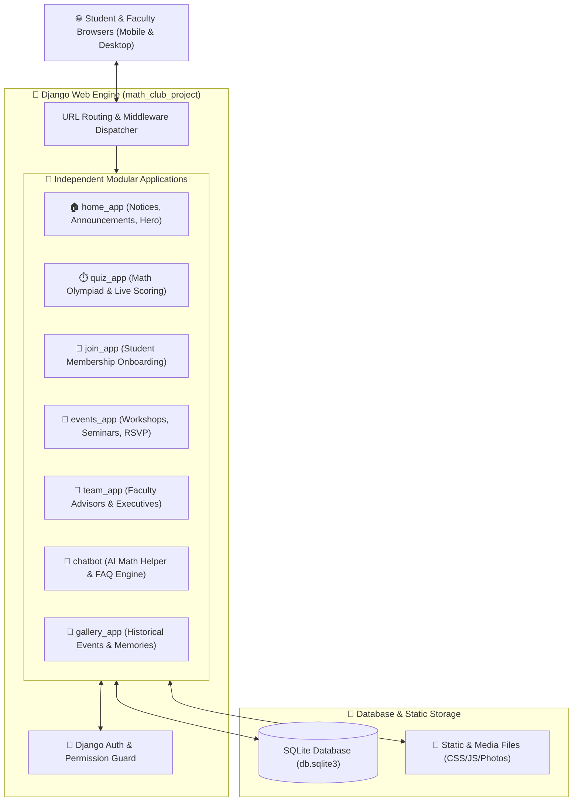

<div align="center">

# 🧮 UAP CSE Math Club — Digital Portal & Competition Platform

[](https://www.python.org/)
[](https://www.djangoproject.com/)
[](https://www.sqlite.org/)
[](#)
[](#)

<p align="center">
  <b>The official digital community portal and event platform for the University of Asia Pacific (UAP) CSE Math Club.</b>
  <br />
  Featuring automated membership onboarding, real-time math Olympiad competitions, interactive event scheduling, and an integrated AI Math Assistant.
</p>

[📌 About the Project](#-about-the-project) • [🛠️ Tech Stack](#️-comprehensive-tech-stack) • [🏛️ Multi-App Architecture](#️-2d3d-multi-app-architecture) • [🚀 How to Run](#-complete-how-to-run--installation-guide) • [✨ Key Modules](#-modular-features)

---

</div>

## 📌 About the Project

The **UAP CSE Math Club Portal** is built to bridge academic curiosity and competitive problem-solving. It centralizes student activities for the Math Club at the University of Asia Pacific (UAP), enabling students to register as official club members, compete in timed online mathematics Olympiads, register for workshops, and seek guidance from an integrated AI chatbot assistant.

---

## 🛠️ Comprehensive Tech Stack

| Layer | Technology | Details / Purpose |
| :--- | :--- | :--- |
| **Backend Framework** | **Django** | Modular MVT architecture, ORM, URL dispatcher, and session auth |
| **Programming Language** | **Python 3.10+** | Server-side execution, data validation, quiz grading algorithms |
| **Database** | **SQLite3** | Relational storage for users, quizzes, event RSVPs, and leaderboard scores |
| **Frontend Templates** | **Django Templates (DTL)** | Modular Jinja2-style reusable layout blocks (`base.html`, includes) |
| **Styling & Assets** | **Custom CSS3 + Bootstrap** | Responsive mobile-first grid, card layouts, dark/light aesthetics |
| **Interactivity** | **JavaScript (ES6+)** | Dynamic quiz timers, instant answer verification, and chatbot UI |
| **AI Assistant** | **Chatbot App** | Contextual responses answering math queries and club FAQs |

---

## 🏛️ 2D/3D Multi-App Architecture



---

## ✨ Modular Features

- **🏆 Real-Time Math Olympiad (`quiz_app`)**: Timed tests with automatic scoring, instant results, and dynamic leaderboards.
- **📝 Student Membership Onboarding (`join_app`)**: Form validation verifying UAP student IDs, departments, and semesters.
- **📅 Event Calendar (`events_app`)**: Schedules for national math Olympiads, university programming camps, and guest lectures.
- **🤖 Built-in AI Math Assistant (`chatbot`)**: Interactive conversational helper answering math logic questions and club inquiries.
- **📸 Event Archival Gallery (`gallery_app`)**: Categorized photo memories of past contests and prize-giving ceremonies.

---

## 📂 Codebase Organization

```plaintext
Math_Club_CSE/
├── 📁 math_club_project/     # Root project configuration & settings.py
├── 📁 home_app/              # Landing page, announcements, newsfeed
├── 📁 quiz_app/              # Real-time quiz models, questions, results
├── 📁 events_app/            # Event creation, calendaring, RSVP logic
├── 📁 team_app/              # Committee profiles & faculty advisers
├── 📁 join_app/              # Club membership onboarding workflow
├── 📁 chatbot/               # AI chatbot interface & response handler
├── 📁 gallery_app/           # Event photo albums & galleries
├── 📁 contact_app/           # Inquiries & student feedback handling
├── 📁 templates/             # Centralized HTML templates
├── 📁 static/                # CSS stylesheets, JavaScript plugins, custom assets
├── 📄 manage.py              # Django administrative CLI
└── 📄 requirements.txt       # Python dependencies
```

---

## 🚀 Complete How-To-Run & Installation Guide

### 1. Prerequisites
- **Python 3.10 or higher** installed (`python --version`)
- **Git** installed

---

### 2. Step-by-Step Installation

#### Step 1: Clone the Repository
```bash
git clone https://github.com/MominRifat/Math_Club_CSE.git
cd Math_Club_CSE
```

#### Step 2: Set Up Virtual Environment
```bash
# Windows (PowerShell):
python -m venv venv
.\venv\Scripts\activate

# macOS / Linux:
python3 -m venv venv
source venv/bin/activate
```

#### Step 3: Install Dependencies
```bash
pip install --upgrade pip
pip install -r requirements.txt
```

#### Step 4: Run Database Migrations
```bash
python manage.py makemigrations
python manage.py migrate
```

#### Step 5: Create Admin Superuser (Optional, for admin panel access)
```bash
python manage.py createsuperuser
```

#### Step 6: Start Development Server
```bash
python manage.py runserver
```

Now open your web browser and go to:  
👉 **`http://127.0.0.1:8000/`**

---

## 👨‍💻 Author

**Momin Rifat**  
- University of Asia Pacific (UAP)  
- GitHub: [@MominRifat](https://github.com/MominRifat)  
- Location: Dhaka, Bangladesh
