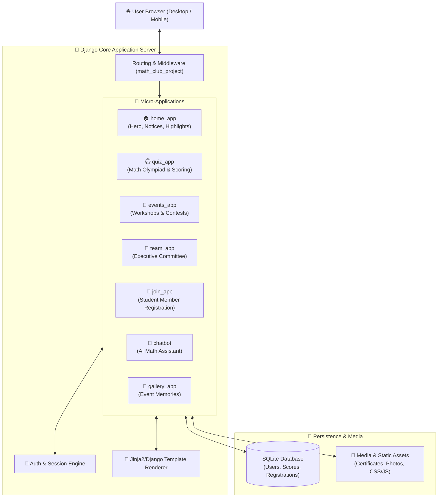

<div align="center">

# 🧮 UAP CSE Math Club — Web Portal & Community Hub

[](https://www.python.org/)
[](https://www.djangoproject.com/)
[](https://www.sqlite.org/)
[](https://developer.mozilla.org/en-US/docs/Web/JavaScript)
[](#)

<p align="center">
  <b>The official digital platform for the University of Asia Pacific (UAP) CSE Math Club.</b>
  <br />
  Featuring member registration, live mathematics Olympiad/quiz engine, interactive event management, automated announcements, and an integrated AI Math Chatbot.
</p>

---

</div>

## 📌 Project Overview

**UAP CSE Math Club** is a full-featured web portal created to foster mathematical curiosity, competitive problem-solving, and community engagement among university computer science students. Built with Django's scalable modular architecture, the system provides real-time quizzes, automated membership registration, and event scheduling.

---

## 🏛️ 2D/3D Multi-App Architecture



---

## 🌟 Modules & Features

| Module | Features & Capabilities |
| :--- | :--- |
| **Quiz & Contest Engine** | Timed mathematics challenges, multiple-choice Olympiad questions, dynamic score tallying, and instant result feedback. |
| **Club Membership Portal** | Online registration form with student ID validation, department tracking, and automated profile generation. |
| **Event Management** | Showcase upcoming seminars, workshops, and inter-university programming/math tournaments with RSVP tracking. |
| **Interactive AI Chatbot** | Built-in conversational helper to answer mathematical questions and guide members across club activities. |
| **Executive Showcase** | Profiles of faculty advisors, executive committee members, and student coordinators. |
| **Media Gallery** | High-resolution gallery archive documenting past events, workshops, and award ceremonies. |

---

## 📂 Codebase Organization

```plaintext
Math_Club_CSE/
├── 📁 math_club_project/     # Root project configuration & settings
├── 📁 home_app/              # Landing page, announcements, newsfeed
├── 📁 quiz_app/              # Real-time quiz models, questions, results
├── 📁 events_app/            # Event creation, calendaring, RSVP logic
├── 📁 team_app/              # Committee profiles & hierarchy
├── 📁 join_app/              # Club membership onboarding workflow
├── 📁 chatbot/               # AI chatbot interface & response handler
├── 📁 gallery_app/           # Event photo albums & galleries
├── 📁 contact_app/           # Inquiries & student feedback handling
├── 📁 templates/             # Centralized HTML templates
├── 📁 static/                # CSS stylesheets, JavaScript plugins, custom assets
├── 📄 manage.py              # Django management CLI utility
└── 📄 requirements.txt       # Python dependencies
```

---

## ⚡ Installation & Quick Start

### 1. Clone & Set Up Virtual Environment
```bash
git clone https://github.com/MominRifat/Math_Club_CSE.git
cd Math_Club_CSE

# Create and activate virtual environment
python -m venv venv
# Windows:
venv\Scripts\activate
# Linux/macOS:
source venv/bin/activate
```

### 2. Install Dependencies
```bash
pip install -r requirements.txt
```

### 3. Run Migrations & Start Server
```bash
python manage.py makemigrations
python manage.py migrate
python manage.py runserver
```

Open your browser and navigate to: **`http://127.0.0.1:8000/`**

---

## 👨‍💻 Author

**Momin Rifat**  
- GitHub: [@MominRifat](https://github.com/MominRifat)  
- Location: Dhaka, Bangladesh
